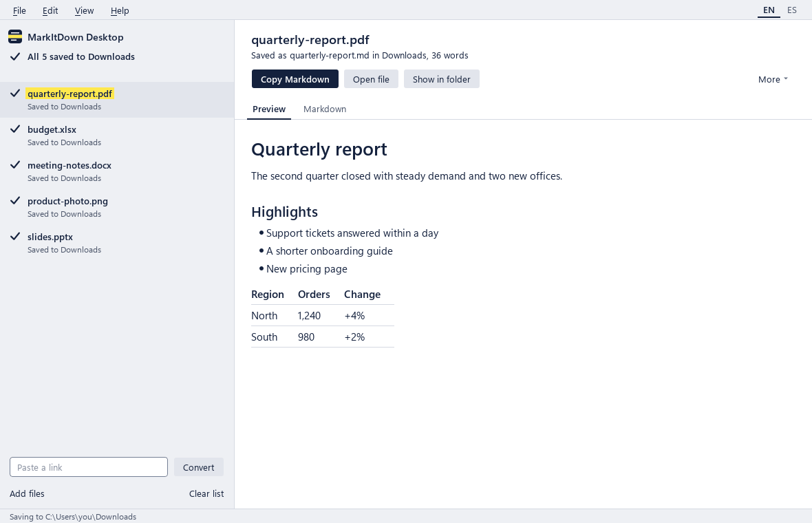

# MarkItDown Desktop (Unofficial)

[](LICENSE)
[](https://github.com/andrest04/markitdown-desktop/releases)
[](#requirements)

A native PySide6 desktop GUI around Microsoft's
[`markitdown`](https://github.com/microsoft/markitdown) Python package.
The core flow is intentionally simple: **drop a file (or paste a URL) and
it converts and saves itself to your Downloads folder automatically** — no
manual "export" step required.

> [!IMPORTANT]
> This app converts files with the privileges of the account running it,
> the same way `markitdown` itself does. Only convert files and URLs you
> trust. See [SECURITY.md](SECURITY.md) for the full policy.

> This is an independent, community-built GUI. It is **not** developed,
> maintained, or endorsed by Microsoft. See [Credits & License](#credits--license)
> below.

<picture>
  <source media="(prefers-color-scheme: dark)" srcset="docs/screenshots/app-dark-en.png">
  
</picture>

**[🌐 Website](https://andrest04.github.io/markitdown-desktop/)** ·
**[⬇️ Download for Windows (.exe)](https://github.com/andrest04/markitdown-desktop/releases/latest/download/markitdown-desktop.exe)** ·
**[Latest release](https://github.com/andrest04/markitdown-desktop/releases/latest)**

## How it works

1. **Add something.** Drop files or folders anywhere in the window, use
   **Add files** or **Add folder**, or paste a webpage or YouTube link and
   press **Convert**.
2. **It converts right away**, in the background. One failed file never stops
   the rest.
3. **The `.md` is already in Downloads**, named after the original. An existing
   file is never overwritten: the new one becomes `document (1).md`.

Select a file to read the result, then **Copy Markdown**, **Open file**, or
**Show in folder**.

## Features

- **A list that answers first.** The line above the list says what is ready and
  what needs you, for example "1 failed, 3 ready". Each row has its own status
  mark, and problem rows give their reason in words and a **Retry** button.
- **Reasons you can act on.** Failures read "unsupported format", "disk full",
  "no text found" and so on, in your language, with the library's own text in
  the detail pane and the row tooltip. A document with no extractable text fails
  with that reason instead of saving an empty `.md`. An image with no EXIF data
  usually needs OCR, which needs Azure Document Intelligence (below).
- **Preview and edit.** The **Preview** tab renders the Markdown at a readable
  line length; the **Markdown** tab holds the raw text, which you can edit
  before copying it or saving a copy.
- **Also save elsewhere.** **More** has **Save a copy...** and **Export all...**.
  These are optional: the save to Downloads has already happened.
- **Light and dark themes**, ink on paper with one highlighter. Follow the
  system or choose in **View**. Status never relies on color alone.
- **English and Spanish.** The language follows your system (Spanish for `es_*`,
  English otherwise), and the EN and ES buttons switch everything live, rows
  included, without a restart.
- **Advanced settings, out of the way.** **Edit > Advanced settings...** holds
  markitdown's plugins, `keep_data_uris`, Azure Document Intelligence, Azure
  Content Understanding, and per-file extension, MIME type and charset hints.

Your window size, theme, language, and last export folder are remembered.

### Keyboard

| Key | Does |
| --- | --- |
| `Ctrl+O` | Add files |
| `Ctrl+Shift+C` | Copy Markdown |
| `Enter`, on a problem row | Retry it |
| `Delete`, in the list | Remove the selected rows |
| `Ctrl+Q` | Exit |

## Supported input formats

Anything `markitdown` supports: PDF, Word, Excel, PowerPoint, images (EXIF
+ optional OCR), audio (transcription), HTML, CSV, JSON, XML, ZIP
archives, EPub, plain text, and YouTube or other web links. See the
[markitdown README](https://github.com/microsoft/markitdown) for the full,
up-to-date list.

## Download a pre-built binary (no Python required)

- **Windows, portable .exe (no install, just run it)**:
  [download `markitdown-desktop.exe`](https://github.com/andrest04/markitdown-desktop/releases/latest/download/markitdown-desktop.exe)
  directly — a single file, no install, no unzip.
- **macOS/Linux**: each [release](https://github.com/andrest04/markitdown-desktop/releases/latest)
  includes a ready-to-run zip — download the one for your OS, unzip, and
  run `markitdown-desktop`.

A zipped Windows build (`markitdown-desktop-windows.zip`) is also available
on the [releases page](https://github.com/andrest04/markitdown-desktop/releases/latest)
if you prefer that format.

The latest release, v1.3.0, predates the interface shown above, which is on
`main` and arrives with the next release. So does a Windows installer
(`markitdown-desktop-setup.exe`) that installs per-user, with no admin rights,
and adds a Start Menu shortcut and an uninstaller.

## Requirements (running from source)

- Windows 10/11, macOS, or Linux
- [Python 3.10+](https://www.python.org/downloads/) (on Windows, check "Add
  python.exe to PATH" during install)
- For audio transcription only: [ffmpeg](https://ffmpeg.org/download.html)
  on PATH

## Installing from source

```bash
git clone https://github.com/andrest04/markitdown-desktop.git
cd markitdown-desktop
python -m pip install -r requirements.txt
```

On macOS/Linux, use `python3` instead of `python` if that's how your
system exposes it.

## Running

- **Windows**: double-click `run.bat`, or run `python main.py`.
- **macOS/Linux**: run `./run.sh`, or `python3 main.py`.

**Show in folder** uses Explorer on Windows, `open -R` on macOS, and `xdg-open`
on Linux. Double-clicking a saved row opens the file.

## Tests

```bash
QT_QPA_PLATFORM=offscreen python -m unittest discover -s tests
```

The suite uses only the standard library's `unittest`, a temporary home folder,
and fake settings, so it never touches your Downloads or your saved preferences.
CI runs it on Windows, macOS, and Linux, along with `ruff check .`, a
byte-compile, and a headless build of the main window.

## Project structure

```
main.py                       entry point
app/core/converter.py         MarkItDown wrapper, background worker, auto-save
app/core/conversion_queue.py  runs items through convert, then save
app/core/queue_model.py       queue items, their states, the table model
app/ui/main_window.py         main window, menus, list and detail panes
app/ui/drop_zone.py           empty-window instruction, add buttons, link field
app/ui/queue_delegate.py      paints the queue rows
app/ui/queue_text.py          the words for the queue summary and detail header
app/ui/status_mark.py         one mark per status
app/ui/brand_mark.py          the app's mark
app/ui/advanced_settings_dialog.py, about_dialog.py
app/ui/theme.py               palette and stylesheets, light and dark
app/i18n.py                   English and Spanish translations
tests/                        unittest suite
docs/                         landing page and screenshots
```

## Contributing

Contributions and suggestions are welcome. See [CONTRIBUTING.md](CONTRIBUTING.md)
for how to get set up and the project's conventions. This project follows
the [Code of Conduct](CODE_OF_CONDUCT.md).

|            | Link                                                              |
| ---------- | ------------------------------------------------------------------ |
| **Issues** | [Open an issue](https://github.com/andrest04/markitdown-desktop/issues) |
| **PRs**    | [Open pull requests](https://github.com/andrest04/markitdown-desktop/pulls) |
| **Security** | See [SECURITY.md](SECURITY.md) for how to report vulnerabilities privately |

## Credits & License

This project wraps [`markitdown`](https://github.com/microsoft/markitdown)
by Microsoft, licensed under the [MIT License](https://github.com/microsoft/markitdown/blob/main/LICENSE).
All actual file-conversion logic is theirs — this repository only adds a
desktop GUI on top of their public Python API. All credit for `markitdown`
itself goes to Microsoft and its contributors.

This GUI's own code is licensed under the [MIT License](LICENSE) as well.
"MarkItDown" is a name used by Microsoft's project; this repository is an
unofficial, unaffiliated GUI and claims no association with or endorsement
by Microsoft.
